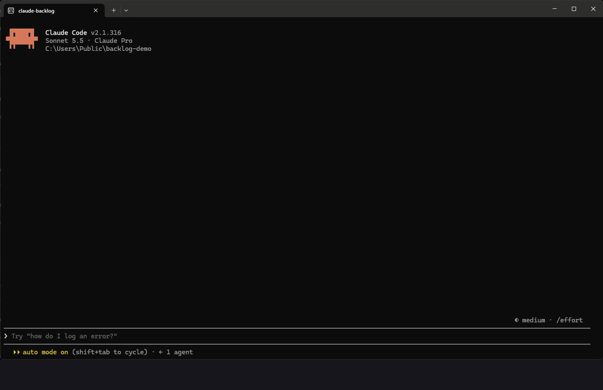

<h1 align="center">claude-backlog</h1>
<p align="center"><strong>Resume work from a plain Markdown backlog, inside Claude Code</strong></p>
<p align="center">Every new session starts cold: you re-explain what is done, what is blocked and what is next.<br>claude-backlog checks your <code>TODO.md</code> against git and tells Claude where you really are, with one next step.</p>

<p align="center">
  
</p>

```
/plugin marketplace add lex0tan/claude-backlog
/plugin install backlogs@claude-backlog
```

<p align="center">
  <a href="https://github.com/lex0tan/claude-backlog/actions/workflows/test.yml"></a>
  <a href="LICENSE"></a>
  
  
</p>

> **claude-backlog** is a Claude Code plugin (command: `/backlogs`) that reads the `TODO.md` files you already have,
> checks them against git and the repository, and tells Claude where you really are.
> No server, no account, no database: the backlog lives only in your files.

## Why

A new session starts cold. You re-explain what is done, what is blocked and what comes next, and the model
guesses from stale notes. Notes drift: items are finished but still listed, "next" points at something already
shipped, two sessions edit the same item.

claude-backlog fixes the starting point, not the way you write:

1. **It verifies before it tells.** Each item is checked against git (commits that cite its ID, how long it has been
   untouched) and the files it mentions. What it cannot verify is reported as *not verifiable*, never as a to-do.
2. **It gives one next step**, not a list of everything.
3. **It keeps sessions apart.** The item a session works on is locked, so a second session does not take it.
4. **It keeps the backlog small.** A finished item is removed from the file; history lives in `git log`.

## Features

- 📝 **Markdown-native**: items are lines in `TODO.md`, with types, dependencies, parts and "done when" checks
- 🗂️ **Grows with you**: one flat file, then an index of workstreams, then nested subprojects
- 🔎 **Finds your projects**: scans the workspace for backlogs, resolves a request such as "resume the website" to a project, workstream or item
- ✅ **Verified state**: stale items, overdue dates, broken links, duplicate IDs and dependency cycles (shown with the chain that closes them)
- 🧭 **Side panel**: agenda, projects → areas → types → items, "Unblock first", "Waiting on you", search, new item, done; arrows and Enter, or one-key shortcuts
- 🎨 **Live status line**: the item in progress beside the prompt, in colour, with a bar of its parts that fills as Claude ticks them and the time spent
- 🔒 **Multi-session safe**: per-session active item, heartbeat, orphan detection, resume or release; backlog files written atomically under a per-file lock
- 🛡️ **Guards**: the session reads only its item's files, backlog edits are re-checked, commits are reminded to cite the item ID
- 🔁 **Adopts what you have**: `/backlogs adopt` proposes how to bring existing notes into the model, nothing is written until you agree, and a file git cannot restore is copied aside first
- 🌍 **Languages**: English and Italian included, add yours by copying one JSON file
- 🧩 **Scriptable**: the script behind it is a plain Node CLI that prints JSON and uses only the standard library

## Install

Requirements: Claude Code (terminal, desktop app or IDE extension) and Node.js 20 or newer. git is optional:
without it item ages fall back to file times and commit checks are skipped.

```
/plugin marketplace add lex0tan/claude-backlog
/plugin install backlogs@claude-backlog
```

or from a shell:

```
claude plugin marketplace add lex0tan/claude-backlog
claude plugin install backlogs@claude-backlog
```

The desktop app installs it from the same marketplace.

## Quick start

1. In your project folder run `/backlogs init`. It creates a `TODO.md` (and a `.backlog.json`) in the model below.
   Already have notes? `/backlogs adopt` finds backlog-like files and proposes how to bring them into the model.
2. Run `/backlogs` to open the panel, or ask in plain words:

   ```
   /backlogs resume the website
   /backlogs plan API
   /backlogs do API-002
   ```

3. Claude answers with the verified state and one next step. When you start an item, it becomes the session's
   active item; when it is finished, the item is removed from the file and `Next:` moves on.

There is a small workspace to try it on in [`examples/demo`](examples/demo).

## Strongly recommended: CodeGraph

We strongly recommend using claude-backlog together with [CodeGraph](https://github.com/colbymchenry/codegraph).
The two cover the two halves of a cold start: claude-backlog tells Claude *what* to work on and loads only that
item's backlog; CodeGraph lets Claude read only the code that item touches (the relevant symbols and the call paths
between them) instead of whole files. Sessions start faster and use far fewer tokens.

```
npm install -g @colbymchenry/codegraph
codegraph init    # in each project, builds the .codegraph/ index
```

CodeGraph is a separate project with its own license; claude-backlog works without it.

## How it works

```
 TODO.md files ──► scripts/backlog.mjs ──► JSON ──► skill (instructions for Claude)
 (your backlog)    discover · parse · check         ▲
                   git ages · routing · locks       └── panel + guards (hooks)
```

- **The script** (`scripts/`, standard library only) finds the projects, parses the items, builds the dependency graph,
  reads git and prints JSON. It is the only thing that touches your backlog files.
- **The skill** (`skills/session/`) tells Claude how to use that JSON for each mode (`audit`, `resume`, `plan`, `do`, `adopt`, `init`, `split`).
- **The hooks** (`hooks/`) draw the panel, keep the per-session state and run the guards.

The plugin stores nothing about your backlog: only session state (active items, locks, a count of closed items).

## The backlog model

A backlog grows in three steps; every step is plain Markdown and the plugin reads all of them.

**1. Flat.** One `TODO.md`:

```markdown
# Shop

## Status

- Next: `SHOP-002`

- [ ] [SHOP-002] `[code]` Product list
  Done when: the list renders
- [ ] [SHOP-003] `[decision]` Payment provider
  Depends on: `SHOP-002`
```

**2. Indexed.** `TODO.md` becomes an index with a table of workstreams, each in its own file:

```markdown
| ID | Name | File | Status | Block | Alias |
|---|---|---|---|---|---|
| `API` | Backend API | `todo/api.md` | in progress | — | api, backend |
| `WEB` | Website | `todo/web.md` | open | — | web, site |
```

**3. Subprojects.** A section titled `Subprojects` with the same table, pointing at the index of a folder that has its own backlog (`mobile/TODO.md`). Those can nest, up to `maxDepth` levels.

Rules the plugin relies on:

- **A finished item is removed.** History lives in `git log`; the file only holds what is open. `/backlogs` removes an item with the `done` command and moves `Next:` along. With `archive` set, `done` also keeps the item in a file per month.
- **IDs** are uppercase words and a number of three or more digits: `SHOP-002`, `SHOP-API-001`, `X-1000`.
- **IDs are unique in the workspace.** Use `project:ID` to name one when in doubt. `split` renumbers a flat backlog into workstreams (`SHOP-001` becomes `SHOP-API-001`) and keeps the old ID in a `Was:` line so old commits still match.
- **Types** go in backticks after the ID: `[code]`, `[content]`, `[decision]`, `[blocked]`… Any word works; `decision` and `blocked` have a meaning, see below.
- **Sub-lines** under an item: `Done when:` (the check that proves it is finished), `Depends on:`, `Blocks:`, `From: YYYY-MM-DD` (not before this date) and `Was:`.
- **Parts** are indented checkboxes under an item. A part starting with `User:` is a step only you can do.
- **Waiting on you:** an item of type `decision`, or one whose open parts are all `User:` steps, is listed apart from the work Claude can do.
- **Dependency cycles** are detected and shown with the chain that closes them.
- **Your formatting stays.** Each file keeps its own line endings (LF or CRLF) and byte order mark when the plugin writes to it.

## Commands

`/backlogs` opens the panel. `/backlogs <mode> <request>` runs the `session` skill:

| Mode | What it does |
|---|---|
| `audit` | Verified state of the scope, with what could not be verified |
| `resume` | The state and one concrete next step |
| `plan` | Plans a workstream from its open items |
| `do` | Works one item by ID, then stops |
| `adopt` | Brings an existing backlog into the model |
| `init` | Sets up a backlog in the current folder |
| `split` | Splits a flat backlog into workstreams |

The script behind it prints JSON and can be run on its own: `node scripts/backlog.mjs <command>`.

| Command | Purpose |
|---|---|
| `route "<request>"` | Which project, workstream and item a request is about |
| `item <ID>` | One item with its context and the commits that cite it |
| `list [--project P]` | Projects, workstreams and open items |
| `summary` | Numbers per project, plus backlogs to adopt |
| `files` | Every backlog file of the workspace |
| `git [project]` | Branch, last commit and changed files per project |
| `check [--project P] [--fast]` | Consistency check (`--fast` skips what needs git) |
| `done <ID>` | Remove a finished item |
| `add <project or workstream> <type> <text>` | Append an item |
| `overview [--write]` | The generated overview block |
| `init`, `split`, `adopt scan`, `adopt write` | Set up and migrate (`adopt write` first copies a source file git cannot restore to `.backlog/backup/<date>/`) |

Common options: `--cwd DIR`, `--project P`, `--dry-run`, `--input FILE`, `--today YYYY-MM-DD`.

## Configuration

Everything has a default. Put overrides in a `.backlog.json` at the workspace root (the outermost one wins as root; a project's own file overrides the workspace's):

```json
{
  "language": "en",
  "keywords": {},
  "exclude": [],
  "maxDepth": 4,
  "projects": [],
  "aliases": [],
  "prefix": null,
  "overview": null,
  "archive": null,
  "staleDays": 30,
  "overdueDays": 3,
  "lockMinutes": 5,
  "typeOrder": [],
  "index": "TODO.md"
}
```

| Key | Meaning |
|---|---|
| `language` | Keyword and panel language (`en`, `it`) |
| `keywords` | Overrides for single keywords, e.g. `{ "next": "Up next:" }` |
| `exclude` | Folders the project scan skips, on top of the built-in ones (`node_modules`, `.git`, `dist`, `build`, `vendor`, virtual environments…) |
| `maxDepth` | How deep the scan looks for projects |
| `projects`, `aliases` | Register folders the scan misses; extra names for routing |
| `prefix` | ID prefix for new items |
| `overview` | A file whose block between `<!-- backlog:start -->` and `<!-- backlog:end -->` is generated |
| `archive` | A folder, relative to the project, where `done` keeps each closed item in a file per month (`done/2026-11.md`) instead of only deleting it. Off by default |
| `staleDays` | An item untouched this long is flagged stale |
| `overdueDays` | A `From:` date this far in the past makes the item overdue |
| `lockMinutes` | How long a silent session keeps its item before it counts as orphaned |
| `typeOrder` | Order of item types in the panel |
| `index` | Name of the index file |
| `workspace` | `true` marks a folder as the workspace root (written by `init --workspace`) |

A value of the wrong type (a string for `staleDays`, an object for `exclude`) stops the script with an error that names the file and the key.

To add a language, copy `lang/en.json` to `lang/<code>.json` and translate the keywords, messages and panel texts.

## The panel

`/backlogs` shows the agenda (items with a `From:` date), then projects → areas → types → items. From an item you can read its detail, see what blocks it and what it unblocks, work on it, or mark it done. **Unblock first** lists the items that hold up most others, **New item** appends one, and a search box finds items by ID or words. **Waiting on you** lists decisions and your own steps.

**Work on it** sends Claude the whole item in one prompt and makes it this session's active item. When the model removes it from the file the session closes it and reports the files left uncommitted; the workspace view counts the items closed today. **Stop working on it** lets go of the item without closing it, and an item whose file disappears is let go on its own. `/backlogs do <ID>` takes the item the same way.

**Keys.** The arrows (or Tab) move the highlight and Enter opens a row or presses a button; Esc closes the panel. Every row has a shortcut shown before it: a digit for projects, areas, types and items, a letter for the agenda. Buttons have one too:

| Key | Button |
|---|---|
| `p` | Projects (back to the start) |
| `b` | Back one level, or Cancel |
| `s` · `a` · `w` | Unblock first · New item · Waiting on you |
| `n` | Next page of a long list |
| `l` · `f` · `y` | Work on it · Done · Yes, remove |
| `x` · `z` | Stop working on it (in the item, at the start) |
| `r` · `x` | Resume · Release an orphan |

The search box and the new item's text field take typing when the highlight is on them.

### Status line

While an item is in progress the line under the prompt shows it: `▶ ID` in yellow, a green bar of its parts done with the count, and the time spent. It moves after every edit and shell command and once a minute, not only at the end of a turn. When the item is closed it turns into `✓ ID done` in green, with the time it took and, in yellow, the files left uncommitted.

The terminal and the desktop app draw it in colour after the line Claude Code and other plugins already show there. VS Code and the mobile app get the same text as a plain status line.

### Several sessions

Each session keeps its active item in the plugin's store with a heartbeat every minute. An item another live session holds is marked *in progress elsewhere* and cannot be taken, from the panel or with `/backlogs do`; the modes also tell the skill which items to leave alone. Items are matched by file, so it does not matter which folder each session started from. If a session goes silent for `lockMinutes` its item becomes an **orphan**: the next session in the same workspace is told, and the panel offers **Resume** or **Release**. Orphans are never taken automatically. A `/clear` may give the session a new ID: the item then shows as an orphan of your own session, and **Resume** takes it back (it is offered while the session holds no item of its own). Entries of sessions silent for a month are deleted when a session starts.

Writes are safe across sessions too. The script is the only thing that writes backlog files: it writes to a temporary file and renames it over the old one, and `done` and `add` hold a lock on the file while they read and rewrite it (a lock older than 30 seconds is taken over). Two sessions closing or adding items in the same file never lose a change or get the same ID.

## Limits

- **Session locks work on one machine only.** The item a session holds, the heartbeat and the orphan detection live in the plugin's own store on that machine, not in your repo. They do not protect an item between two worktrees or two computers: each side sees the item as free. If you work from several places, pick the items yourself. (A lock file such as `.backlog/locks/<ID>` that travels with the repo is a possible future option.)
- The per-file write lock (see above) has the same scope: it keeps sessions on one machine from overwriting each other, not clones of the repo.

## What it runs, sends and stores

- **Programs it runs.** `node` runs the plugin's own `scripts/backlog.mjs` (reads and writes your backlog files, no network), and `git` runs read-only queries (`log`, `blame`, `status`, `ls-files`, `branch`, `rev-parse`) on the current workspace to date items and check commits. Nothing else is started.
- **What it sends.** Nothing leaves your machine: no network calls, no telemetry, no account. It reads no credentials or environment secrets.
- **Prompts it submits.** `/backlogs <mode> <request>` and the panel's *Work on it* submit one prompt as if you had typed it: the mode's instructions, the item's text and the names of its backlog files. Nothing else is added to your prompts; the only other text it adds to the session is the check results after a backlog edit and the commit reminder.
- **What it stores.** Session state (active item, heartbeat, a count of closed items) in the plugin's own store on your machine.

## Guards

Three hooks keep the session on track. None of them blocks an edit or a commit; only the read guard can refuse, and only while an item is active.

- **Read guard.** The prompt already carries the item, so reading other backlog files is refused; only the item's file and its indexes stay open.
- **Check after an edit.** With or without an active item, when Claude edits a backlog file, the plugin runs `check --fast` before and after and reports only the new issues back as context.
- **Commit reminder.** A commit that does not cite the active item's ID gets a reminder afterwards.

## Development

```
node --test test/*.test.mjs   # script and example tests
claude plugin test .          # panel and guard tests
claude plugin validate .
```

CI runs the script tests on Windows, macOS and Linux with Node 20 and 22, and the panel tests and validation with Claude Code.

Layout: `scripts/` (the CLI, standard library only), `skills/session/` (instructions for Claude), `hooks/` (panel, status line, session state, guards), `lang/` (keywords and texts per language), `examples/demo/`, `.github/` (CI and the demo GIF).

## License

MIT, see [LICENSE](LICENSE).
